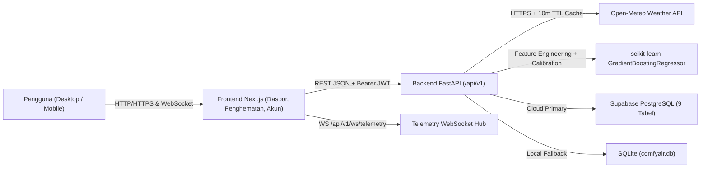

# Arsitektur Sistem ComfyAir

ComfyAir dirancang menggunakan arsitektur *decoupled full-stack* yang memisahkan antarmuka web minimalis 3 halaman (Next.js) dengan layanan API cerdas (FastAPI + scikit-learn) dan penyimpanan relasional *cloud* (Supabase PostgreSQL / SQLite).

## Diagram Arsitektur

---

## 1. Implementasi Jaringan Komputer

| Komponen | Protokol / Mekanisme | Detail Implementasi |
| :--- | :--- | :--- |
| **REST API** | `HTTP/1.1` / `HTTPS` JSON | Endpoint versi `/api/v1/*` dengan validasi skema ketat Pydantic v2 (`backend/app/api/v1/*`) |
| **Weather Upstream** | `HTTPS` (`httpx.AsyncClient`) | Konsumsi API Open-Meteo untuk 8 kota Indonesia dengan *timeout* 3,5 detik dan *TTL cache* 10 menit |
| **Real-time Telemetry** | `WebSocket` (`WS`) | Endpoint `/api/v1/ws/telemetry` menyiarkan paket event prediksi & umpan balik secara langsung |
| **Network Observability** | HTTP Middleware & Headers | Header respons `X-Process-Time-Ms` mencatat durasi pemrosesan server; `/api/v1/health` membaca `X-Forwarded-For` untuk identifikasi IP klien |
| **Keamanan Sesi** | Bearer JWT (`HS256`) + Refresh Token | Autentikasi tanpa *state* pada header `Authorization`, dengan pencatatan `ip_address` dan `user_agent` pada tabel `sessions` |

---

## 2. Implementasi Komputasi Awan

- **Database-as-a-Service (Supabase PostgreSQL):** Menggunakan skema 9 tabel ([backend/schema.sql](../backend/schema.sql)): `roles`, `users`, `sessions`, `refresh_tokens`, `user_preferences`, `comfort_feedback`, `weather_data`, `temperature_recommendations`, dan `energy_saving_logs`.
- **Automatic Local Fallback:** Apabila variabel `SUPABASE_URL` dan `SUPABASE_KEY` belum diisi saat pengembangan lokal, [storage.py](../backend/app/core/storage.py) otomatis menginisialisasi skema identik pada `SQLite` lokal dengan akun demo siap pakai.
- **Containerization & Cloud Hosting:** `backend/Dockerfile` dan `frontend/Dockerfile` membungkus layanan dalam kontainer independen pada jaringan Docker `comfyair-net`, dengan templat deployment untuk **Microsoft Azure Web App / Container Apps** dan **GitHub Pages**.

---

## 3. Implementasi Kecerdasan Buatan (Machine Learning)

### Fitur & Rekayasa Fitur ([thermal.py](../backend/app/services/thermal.py))
1. `outdoor_temp` (°C)
2. `humidity` (%)
3. `hour` (0–23 WIB, merepresentasikan ritme sirkadian)
4. `mode_encoded` (`ECO=0`, `SLEEP=1`, `COMFORT=2`)
5. `heat_index_c` (*NOAA Rothfusz Heat Index* yang dihitung dari kombinasi suhu dan kelembapan)
6. `ac_power_pk` (kapasitas AC dalam satuan PK)

### Kalibrasi Umpan Balik Personal (`comfort_feedback`)
Setiap kali pengguna menekan `Terlalu dingin` (`+1,0°C`), `Pas` (`0,0°C`), atau `Terlalu panas` (`-1,0°C`) di Dasbor, backend menyimpan catatan tersebut pada tabel `comfort_feedback` dan menghitung bias personal teredam yang langsung mengkalibrasi keluaran `GradientBoostingRegressor` pada prediksi berikutnya.

### Perbandingan Model (Dataset 2.400 Sampel · 80/20 Split · 5-Fold CV)

| Algoritma | CV R² (Mean ± Std) | Test R² | Test MAE (°C) | Test RMSE (°C) | Status |
| :--- | :---: | :---: | :---: | :---: | :--- |
| **`GradientBoostingRegressor`** | **0,9720 ± 0,0040** | **0,9740** | **0,1463** | **0,2031** | **Dipilih (`comfyair_model.pkl`)** |
| `RandomForestRegressor` | 0,9678 ± 0,0041 | 0,9670 | 0,1489 | 0,2288 | Kandidat |
| `Ridge` | 0,7714 ± 0,0177 | 0,7635 | 0,4904 | 0,6128 | Baseline Linear |
| `LinearRegression` | 0,7714 ± 0,0177 | 0,7634 | 0,4902 | 0,6129 | Baseline Linear |
